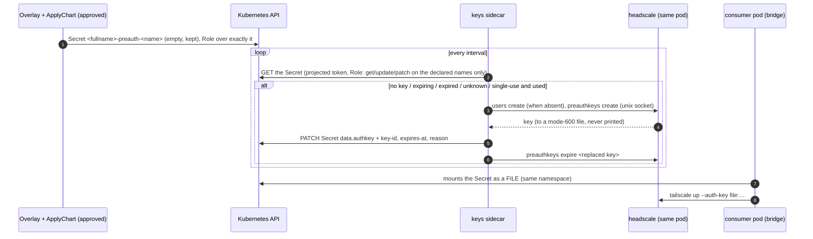

# headscale — the fleet's private network

**One private network that the fleet's machines join with the stock Tailscale client.** Headscale is
the open-source Tailscale control server; the estate runs it behind the cluster's HTTPS ingress, and a
machine joins with:

```bash
tailscale up --login-server https://<host>     # opens a browser: sign in with your work account
```

An admitted account registers the machine with no admin step (OIDC, `oidc.allowed*`). Once joined, the
machines reach each other by private address (`100.64.0.0/10`) and by MagicDNS name
(`<machine>.<dns.baseDomain>`), directly where the networks allow it and through a relay where they do
not. What may reach what is the HuJSON `policy` (default: every member's machines reach each other).

It is the "general network reach to the Macs" need that `Hosting/LocalMeshReach.md` (MeshWeaver.Plugins)
kept apart from the phone app: SSH, screen sharing, a local mesh on another Mac, the build hosts.

## What runs

| Object | Why |
|---|---|
| `Deployment` (one replica, `Recreate`) | the state is a sqlite file on a ReadWriteOnce volume — two pods would corrupt it |
| `PersistentVolumeClaim` (kept on uninstall) | the database AND the Noise private key: losing the key un-registers every machine |
| `ConfigMap` | `config.yaml` + `policy.hujson`; a change rolls the pod (checksum annotation) |
| `Service` + `Ingress` | plain HTTP inside the cluster, TLS at the ingress (cert-manager or a pre-created Secret) |
| `SecretProviderClass` (OIDC via Key Vault) | the client secret is mounted as a FILE and never synced into a Kubernetes Secret |
| `NetworkPolicy` | in: the HTTP port, from the ingress namespace; out: DNS and HTTPS only (issuer, DERP map) |
| `keys` sidecar + `ConfigMap`, a `Secret` per key, `ServiceAccount`, `Role`, `RoleBinding` (only with `preauthKeys.enabled`) | the declared pre-auth keys — below |

The pod runs as uid 65532 on a read-only root with no capabilities and no service-account token (the
keys sidecar alone mounts one, through its own projected volume).
Metrics and gRPC listen on loopback only; the admin CLI talks to the unix socket inside the pod.

## Declared pre-auth keys — joining a machine unattended

A machine that joins with nobody at a browser (the ingress bridge, `deploy/tailnet-bridge/`; a build
host) needs a **pre-auth key**. Minting one by hand means `kubectl exec` into the control server and
pasting the key somewhere. Instead the overlay DECLARES the keys, the governed `ApplyChart` applies the
declaration under its approval, and a sidecar keeps the cluster matching it:

```yaml
preauthKeys:
  enabled: true
  image: { repository: <registry>/headscale-keys }   # tag defaults to image.tag (same commit)
  keys:
    - { name: tailnet-bridge, user: tailnet-bridge, reusable: true, ephemeral: true, validHours: 720, renewHours: 168, tags: ["tag:bridge"] }
```



- The chart creates each Secret EMPTY with `helm.sh/resource-policy: keep` and never renders its key:
  helm's three-way merge leaves the sidecar's `data` and annotations alone on upgrade (they are in
  neither manifest), so `helm template` previews and the stored release manifest never carry key
  material. The sidecar cannot create, list or read any other Secret.
- A key is replaced when it is missing, its DECLARATION changed (user, flags or lifetime — a fingerprint
  is stored with the key), within `renewHours` of its expiry, expired or unknown in headscale, or
  (single-use) already used. The replaced key is expired at once, so nothing new joins with it while
  machines that already joined keep their registration. Its id is recorded in the Secret in the SAME
  write as the new key (`pending-expire`) and retried every pass until headscale confirms it no longer
  accepts it; a key whose Secret write was refused is expired immediately (retried for the life of the
  process if that fails). Every such failure fails the pass and is logged.
- `tags` makes the key a TAGGED key (the machine is addressed by tag in the policy, not as a member of its
  user); the policy's `tagOwners` must grant the tag to that user, or headscale refuses the mint.
- The pod template hashes the declaration only, never the Secrets, so a key renewal does not restart the
  control server.
- The key never appears in a log, an argv or the environment: headscale writes it to a mode-600 file, the
  patch goes from a file (`curl --data-binary @file`), and the consumer mounts the Secret as a file.
- The image `headscale-keys:<line>-<sha>` is the SAME headscale binary with a shell, curl and jq (the
  server image stays the upstream distroless bytes); both are published from one commit. `test/keys.sh`
  runs the loop in the build against a real server and a stand-in API server (`test/kube-stub.py`): 20
  assertions, including a changed declaration, a refused Secret write, and no key in the log.

## Relays (DERP)

Machines that cannot reach each other directly relay through **Tailscale's public DERP servers**
(`derp.urls`). The traffic stays end-to-end encrypted (WireGuard); the relay sees ciphertext. Running
the fleet's own relay is possible later — Headscale embeds one — but it needs UDP 3478 for STUN, which an
HTTP ingress cannot carry, so it is a separate change (a `LoadBalancer` Service of its own).

## The image

`.github/workflows/headscale-image.yml` mirrors the upstream release, **pinned by digest** in the
`Dockerfile`, into the fleet registry as `headscale:<version>-<short sha>` (immutable; the chart refuses
any other tag shape). The build runs `test/smoke.sh` on the shipped binary; the pull-request job then
proves the smoke can go red, serves the CHART's own rendered config as the pod does, joins a stock
Tailscale client to it, and checks every render refusal. The same run publishes `headscale-keys:<version>-<short
sha>` (target `keys-release`), the declared-keys sidecar, whose `test/keys.sh` also runs in the build.

A version bump: change the `HEADSCALE_IMAGE` digest and `LINE` together, read the release notes for the
minimum Tailscale client, and declare the new line in the platform repository's
`.github/release-channels.json`.

## Installing it

Never `helm install` by hand. An estate vendors this chart byte-identical into its private deployments
repository, writes its overlay (host, ingress class and issuer, OIDC issuer/client/allow-list, Key Vault
names) and applies it with the governed `ApplyChart` InstanceAction from a `Hosting/ChartRelease` record.

## Keys for servers — minted by a governed action, never by hand

A person's machine joins with their own sign-in. A SERVER (a pod, a headless Mac) joins with a PRE-AUTH
KEY. Two paths exist, for two shapes of consumer:

- **Declared pre-auth keys** (above): a long-lived, renewed, often reusable key in a Kubernetes Secret in
  the headscale namespace — for a consumer that re-joins as a fresh node on every restart (the ingress bridge).
- **A minted one-time key** (this section): a SINGLE-USE, tagged key stored in Key Vault and mounted by the
  consumer through the Secrets Store CSI driver as a FILE — for a consumer that keeps its node identity on its
  own volume and must never see a Kubernetes Secret (the estate's Grafana node). It is minted by the operator verb `deploy/hosting-operator/bin/hosting-tailnet-key`
— run by the approved secret-write action on the control instance (MeshWeaver.Plugins
`Hosting/AksOperationsViaActions.md` → "A tailnet key"), never by a person with `kubectl exec`:

```
hosting-tailnet-key --namespace <ns> --release <headscale release> --vault <vault> --object <vault object>
                    --tags tag:<a>[,tag:<b>] --expiration <N>m|<N>h
```

1. It finds the ONE running pod of the release and reads the policy that pod RUNS (the ConfigMap its
   `config` volume mounts). **Every requested tag must be declared in `tagOwners`** — Headscale itself mints a
   key for ANY tag (measured on 0.29.7: `preauthkeys create --tags tag:undeclared` answers 0 with a key), so
   this check is the only thing that keeps an approval from minting a tag the reviewed policy never named.
2. It runs `headscale preauthkeys create --tags … --expiration … -o json` inside that pod (the binary
   directly; the image is distroless). Never `--reusable`, never `--ephemeral`, never untagged — and the
   answer is refused unless it reads back single-use, non-ephemeral, with exactly the requested tags.
3. It writes the key into Key Vault through a mode-600 `--file`, tagged with metadata only (`mw-source=
   tailnet-key`, `mw-tags`, `mw-expires`, `mw-key-id`, `mw-fp`, `mw-set-by`, `mw-set-at`), and confirms the
   version by a metadata read. A key the vault does not take is EXPIRED in Headscale before the step fails.
4. The key is never printed, never on an argv, never in a `::hosting::` fact; what crosses back is its id,
   tags, expiry and a sha256 fingerprint.

The expiration is bounded to **10 minutes – 24 hours**: the key's one consumer is the server's next start,
and a single-use key that outlives that window is a standing credential in the vault for nothing. The server
keeps its identity on its own volume afterwards. It runs on the operations lane with that lane's cluster
credential; the in-cluster operator ServiceAccount holds no `pods/exec` and is not widened for it.

## Joining a machine

- **macOS:** `brew install --cask tailscale` (the app, with its network extension) or
  `brew install tailscale` (the open-source daemon, `sudo brew services start tailscale`), then
  `sudo tailscale up --login-server https://<host>`.
- **Linux:** the distribution's `tailscale` package, then the same `tailscale up`.
- Minimum client for Headscale 0.29.7: **v1.80.0**; upstream recommends **v1.104.4 or newer**.
