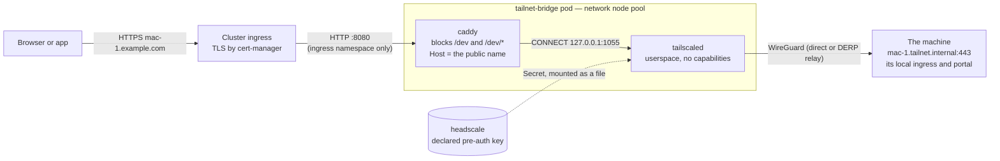

# tailnet-bridge — one machine of the private network at a public name

**A machine on the private network (`deploy/headscale/`) answers at a public name without opening a port.**
The public name points at the cluster's shared HTTPS ingress; the ingress routes it to this bridge, a
small proxy that is itself a member of the network; the bridge forwards over WireGuard to the machine's
local ingress. The machine's own sign-in protects it.



## What runs

| Object | Why |
|---|---|
| `Deployment` (one replica, `Recreate`) | the bridge is one machine on the network; its key is reusable + ephemeral, so a replacement pod joins as a fresh node and the old one is removed when it goes away |
| `Service` + `Ingress` | the public name, TLS at the ingress (cert-manager or a pre-created Secret) |
| `NetworkPolicy` | in: the proxy port, from the ingress namespace; out: DNS, and HTTPS/HTTP/UDP to PUBLIC addresses only (the control server, DERP relays, STUN, WireGuard peers) — nothing inside the cluster |

The pod runs as uid 65532 on a read-only root with no capabilities and no service-account token.
tailscaled runs in **userspace** (no TUN device): it exposes an HTTP proxy on loopback, and caddy sends
every upstream request through it as a `CONNECT` tunnel, which is also why the target must be `https://`
(an `http://` upstream is sent to a proxy as an absolute-URI request, which tailscaled does not forward).

## The key

The bridge joins with a pre-auth key it reads from a FILE: the Secret `network.authKeySecret` (key
`authkey`) in its own namespace, which the control server's **declared pre-auth keys** sidecar keeps
valid (`deploy/headscale/README.md` → *Declared pre-auth keys*). Declare it reusable and ephemeral:

```yaml
# the headscale overlay
preauthKeys:
  enabled: true
  image: { repository: <registry>/headscale-keys }
  keys:
    - { name: tailnet-bridge, user: tailnet-bridge, reusable: true, ephemeral: true }
# the bridge overlay
network:
  loginServer: https://<headscale host>
  authKeySecret: <headscale fullname>-preauth-tailnet-bridge
```

Until the sidecar has filled the Secret the bridge exits ("no pre-auth key … yet") and the pod restarts.

## The machine's side, and what protects it

- **TLS to the machine, with the public name.** The bridge connects to `https://<target.name>:<port>`
  with SNI and `Host` set to the public name (`target.upstreamHost`, default `host`), so the machine's
  portal builds its links and sign-in callbacks for the public name. The hop runs inside WireGuard,
  which authenticates the machine by its node key, and a local ingress rarely holds a certificate for
  the public name — so `target.insecureSkipVerify` defaults to true. Set it false when the machine's
  ingress holds a certificate the bridge can verify.
- **The machine's own sign-in.** The bridge forwards everything except `blockedPaths`, which it answers
  `404` itself. The default blocks a local portal's development sign-in (`/dev`, `/dev/*`), which admits
  anyone who can reach it. That block is defence in depth: the portal itself must refuse an open sign-in
  on a non-local host, and a machine published here needs a real sign-in provider for its public name.
- **Who may reach the machine at all** is the network's policy (headscale `policy`): the bridge is a
  member of the user its key belongs to.

## The image

`.github/workflows/tailnet-bridge-image.yml` builds the stock Tailscale client image and Caddy, both
**pinned by digest** in the `Dockerfile`, into one image `tailnet-bridge:<tailscale version>-<short sha>`
(immutable; the chart refuses any other tag shape). The build runs `test/smoke.sh` (the generated proxy
config, every refusal, health / blocked / forwarded answers, no start without a key). The pull-request
job then proves the smoke goes red with nothing blocked, runs `test/e2e.sh` — a real control server, a
member reachable on the private network only, the bridge joining with a key from a file and forwarding
to it over TLS with the public `Host` — and checks every chart refusal.

## Installing it

Never `helm install` by hand. An estate vendors this chart byte-identical into its private deployments
repository, writes one overlay per published machine (`host`, `target.name`, ingress class and issuer,
the key Secret) and applies it with the governed `ApplyChart` InstanceAction from a `Hosting/ChartRelease`
record whose `host` and `dnsZone` also write the public name's DNS record.

## Capabilities (2026-11-07)

The container drops every capability but keeps `NET_BIND_SERVICE`. The pinned caddy binary carries the
file capability `cap_net_bind_service`, and with all capabilities dropped and `allowPrivilegeEscalation:
false` the kernel refuses to exec it — `/usr/local/bin/tailnet-bridge: line 89: caddy: Operation not
permitted`, CrashLoopBackOff — even though it listens on 8080. Measured on control with the first
deployment of the bridge (`tailnet-bridge-eiger`, since removed: the owner decided not to publish eiger
for now). Keep the capability in any chart that runs this image.
